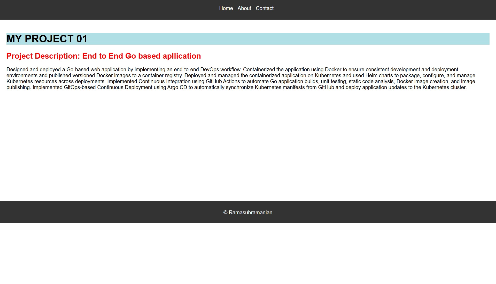
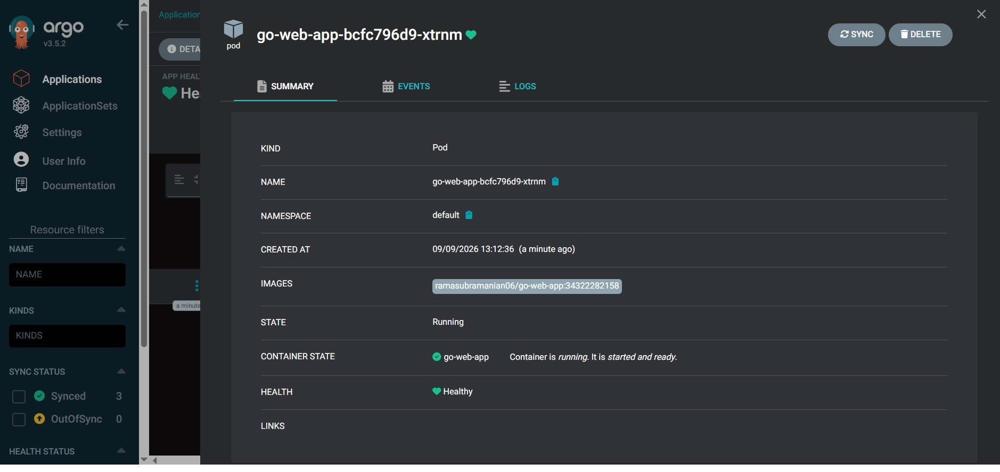

# 🚀 Go Web App: CI/CD, GitOps & Cluster Diagnostics on AWS EKS using K8sGPT-AI

A lightweight Golang web application, wrapped in a complete production-style DevOps pipeline: **GitHub Actions → Docker Hub → Helm → ArgoCD → AWS EKS**.

The app itself is intentionally simple — a `net/http` server serving three static pages. The point of this project isn't the app; it's proving I can take application from a `git push` to a running pod on a Kubernetes cluster, automatically, safely, and repeatably.

I also deployed the K8sGPT operator on the cluster to scan for failing workloads and surface the failing resource and its error message.

Homepage



---

## 🧱 Architecture

```
Developer → GitHub → GitHub Actions CI/CD → Docker Hub → ArgoCD (GitOps) → AWS EKS
                          │                                    │
                    build · test · lint                  Helm chart (auto-synced)
```

**Flow on every push to `main`:**
1. **Build & Unit Test** — compiles the Go binary and runs `go test ./...`
2. **Code Quality** — static analysis via `golangci-lint`, run in parallel with the build
3. **Docker Build & Push** — multi-stage Dockerfile builds a minimal image and pushes it to Docker Hub, tagged with the unique GitHub Actions `run_id` (immutable image tags — no `latest`)
4. **Helm Chart Update** — the pipeline rewrites `values.yaml` with the new image tag and commits it back to the repo, using `paths-ignore` to prevent the commit from re-triggering the pipeline (avoids an infinite loop)
5. **ArgoCD Sync** — ArgoCD watches the Helm chart in Git and automatically deploys the new version to the EKS cluster — no manual `kubectl apply`, ever

This is a **GitOps** pattern: Git is the single source of truth for what's running in the cluster.

Cluster diagnostics (runs alongside, not part of the deploy flow):

K8sGPT Operator → scans Pods / Deployments / Services → creates `Result` objects

---

## 🛠️ Tech Stack

| Layer | Tool |
|---|---|
| **Application** | Go (`net/http`, no external web framework) |
| **CI** | GitHub Actions (build, test, lint) |
| **Containerization** | Docker (multi-stage build → distroless final image) |
| **Registry** | Docker Hub |
| **Package/Deploy** | Helm chart |
| **GitOps CD** | ArgoCD |
| **Orchestration** | Kubernetes (AWS EKS) |
| **Networking** | Kubernetes Ingress (NGINX) |
| **Troubleshooting** | K8sGPT Operator (in-cluster analyzers) |
	
---


## 📁 Repository Structure

```
.
├── main.go                    # HTTP server + route handlers
├── main_test.go                # Unit tests for handlers
├── Dockerfile                  # Multi-stage build → distroless runtime
├── static/                     # HTML pages (home, about, contact)
├── kubernetes/                 # Plain K8s manifests (Deployment, Service, Ingress)
├── helm/go-web-app-chart/      # Helm chart used for actual GitOps deployment
├── k8sgpt/
│   └── k8sgpt.yaml             # K8sGPT custom resource
└── .github/workflows/ci.yaml   # Build → Test → Lint → Push → Update Helm tag
```

---

## ⚙️ Running It Locally

```bash
go build -o main
./main
```
Visit `http://localhost:8080`

---

## ☸️ Kubernetes Deployment with Helm

Helm manages the Kubernetes resources required to deploy the Go application.

The chart is located at:

```text
helm/go-web-app-chart/
├── Chart.yaml
├── values.yaml
└── templates/
    ├── deployment.yaml
    ├── service.yaml
    └── ingress.yaml
```

### Why Helm?

Instead of maintaining every Kubernetes manifest separately for each deployment, Helm uses templates and configurable values.

For example, the image tag is configured in `values.yaml`:

```yaml
image:
  repository: ramasubramanian06/go-web-app
  tag: "YOUR_IMAGE_TAG"
```

The Deployment template references this value:

```yaml
image: "{{ .Values.image.repository }}:{{ .Values.image.tag }}"
```

When the CI pipeline updates the image tag in Git, Argo CD detects the change and synchronizes the Helm chart with the EKS cluster.

This approach improves consistency, reusability, and deployment management.

---

## 🔍 Cluster Diagnostics with K8sGPT

I deployed the [K8sGPT Operator](https://github.com/k8sgpt-ai/k8sgpt-operator) on the EKS cluster to try automated first-pass diagnosis. It scans the cluster and creates a `Result` resource for each issue it finds.

**Configuration:** [`k8sgpt/k8sgpt.yaml`](k8sgpt/k8sgpt.yaml) scans Pods, Deployments and Services every 5 minutes. The OpenAI backend is configured but **disabled** (`ai.enabled: false`), so I used only the built-in analyzers and no cluster data left the cluster.

### Setup

```bash
helm repo add k8sgpt https://charts.k8sgpt.ai && helm repo update
helm install k8sgpt-operator k8sgpt/k8sgpt-operator -n k8sgpt --create-namespace
kubectl apply -f k8sgpt/k8sgpt.yaml
```

### Test scenario

I deployed a pod with a non-existent image and inspected the results:

```bash
kubectl run k8sgpt-test-bad-image --image=nginx:doesnotexist
kubectl get results -A
kubectl describe result <result-name> -n k8sgpt
```

Observed error:

```
0/3 nodes are available:
3 Too many pods.
No new claims to deallocate.
```
### What I found

- K8sGPT detected the test pod and created a `Result` for it.
- The reported error was a scheduling failure, not the image problem: `0/3 nodes are available: 3 Too many pods`. The pod was `Pending`, so it never reached the image pull.
- Cause: the nodes had hit their pod-capacity limit (on EKS this depends on instance type).

### How I resolved it

**1. Confirmed the cause** before changing anything:

```bash
kubectl describe pod k8sgpt-test-bad-image      # Events: FailedScheduling - Too many pods
kubectl describe nodes | grep -E "^Name:|pods:"  # pod capacity vs. allocated, per node
kubectl get pods -A | wc -l                      # total pods running across the cluster
```

All 3 nodes were at their pod limit, because system pods, the K8sGPT operator and my other workloads had used up the available slots.

**2. Added capacity with a new managed node group** (a larger instance type, since EKS pod limits scale with the instance's network interfaces):

```bash
eksctl create nodegroup \
  --cluster <cluster-name> \
  --name ng-extra \
  --node-type t3.large \
  --nodes 1 --nodes-min 1 --nodes-max 2 \
  --managed
```

**3. Verified the fix:**

```bash
kubectl get nodes                                # new node shows Ready
kubectl get pod k8sgpt-test-bad-image -w         # Pending → ErrImagePull / ImagePullBackOff
kubectl get results -A                           # K8sGPT now reports the real image error
```

Once the new node joined, the pod was scheduled and failed with the expected image pull error. K8sGPT then reported that error instead of the scheduling failure.


---

## 📸 Pipeline in Action

| CI Build | Docker Image Pushed | ArgoCD Sync |*
|---|---|---|---|
|  |  |  |

---


**Author:** [Ramasubramanian](https://github.com/ramasubramanian06) — building hands-on toward a DevOps role.
